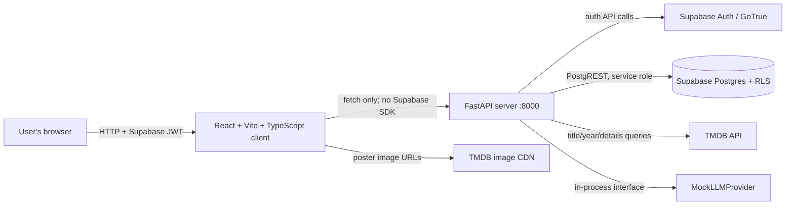
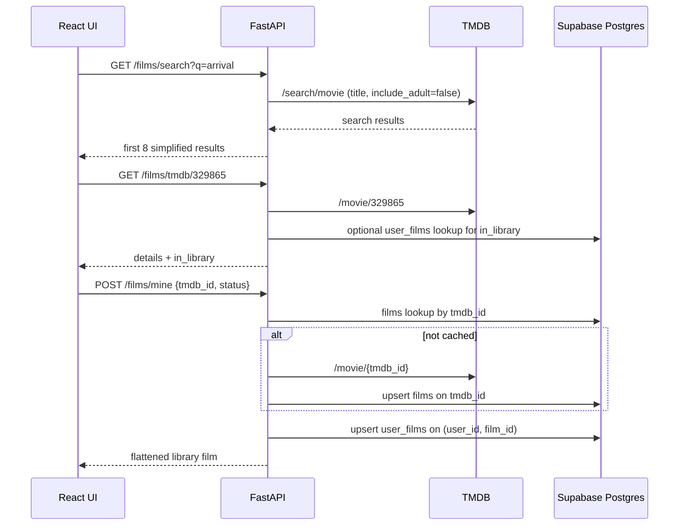
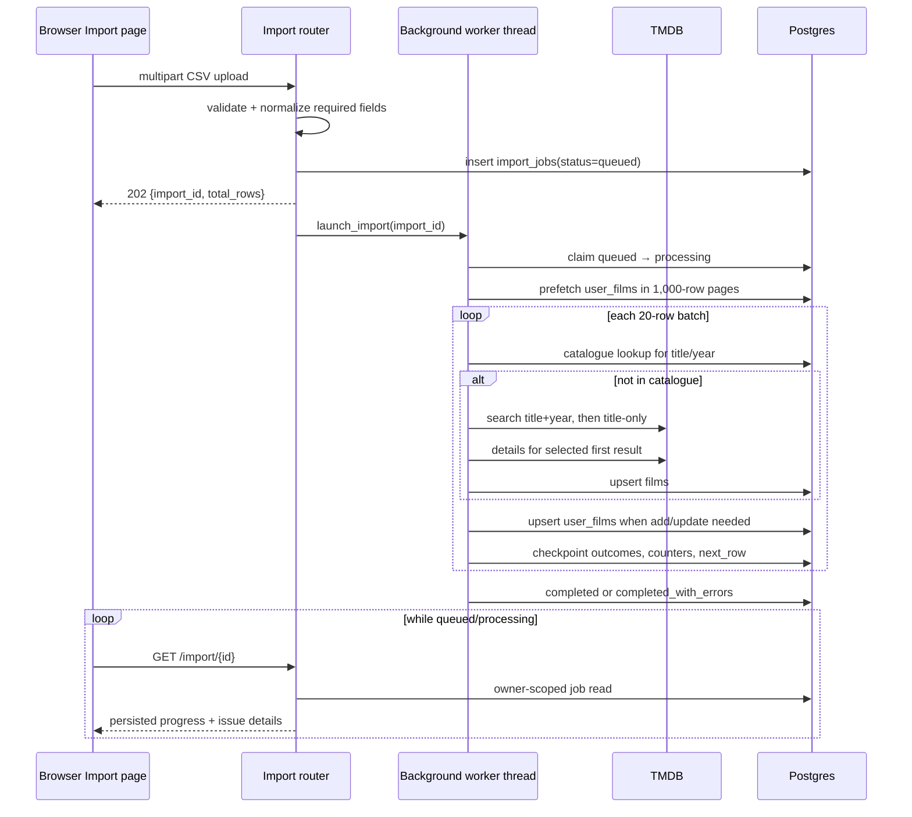
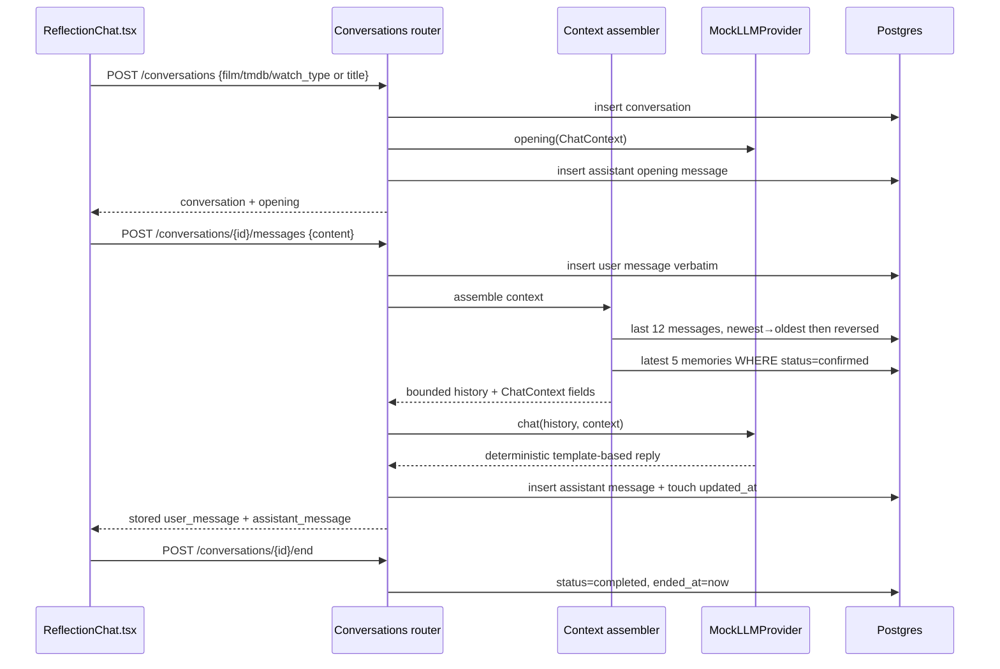
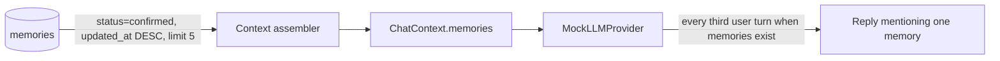
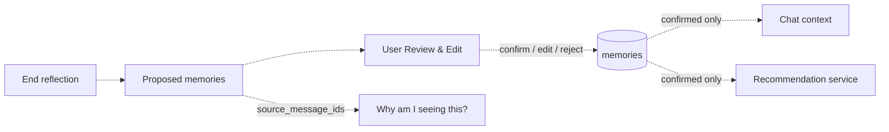
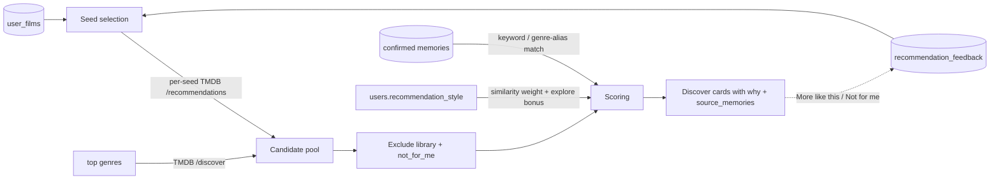

# NOACF — Architecture

> This document describes the code as it exists now. Diagrams marked **planned**
> show intended architecture from project notes, not working endpoints.

## 1. Architecture at a glance

The browser communicates only with FastAPI. It does **not** call Supabase or the
TMDB REST API directly (`client/src/lib/api.ts`). Poster images are the
exception: the API returns absolute image-CDN URLs and `` elements fetch
those public assets directly.

There is currently **no external AI provider node**: `get_llm()` returns an
in-process `MockLLMProvider` when `LLM_PROVIDER=mock`, which is the default and
the only accepted provider value (`server/app/llm/__init__.py`).

## 2. Component responsibilities

| Component | Actual responsibility | Important sources |
|---|---|---|
| React client | Routes, session state, forms, film grids, import progress, reflection UI | `client/src/App.tsx`, `client/src/pages/` |
| API wrapper | Base URL, bearer token, JSON/multipart requests, normalized errors | `client/src/lib/api.ts` |
| FastAPI entry point | CORS, routers, health, import recovery on startup | `server/app/main.py` |
| Auth routes | Supabase Auth operations and `public.users` profile creation/repair | `server/app/routers/auth.py` |
| Auth dependency | Validate bearer token and return user id/email | `server/app/deps.py` |
| Film routes | TMDB search/details, catalogue cache, user library CRUD/pagination | `server/app/routers/films.py` |
| TMDB adapter | HTTP requests, mapping, poster URLs, bounded retry/backoff | `server/app/tmdb.py` |
| Import routes | CSV validation/normalization, job lookup and resume | `server/app/routers/imports.py` |
| Import worker | Background batches, matching, outcomes, checkpoints, recovery | `server/app/import_jobs.py` |
| Conversation routes | Conversation ownership, message persistence, replies, ending | `server/app/routers/conversations.py` |
| Context assembler | Last N messages + K confirmed memories only | `server/app/context.py` |
| LLM seam | Provider interface and selection | `server/app/llm/base.py`, `__init__.py` |
| Mock provider | Deterministic reflective openings/replies; empty extraction stub | `server/app/llm/mock.py` |
| Supabase clients | Separate service-role DB client and Auth client | `server/app/supabase_client.py` |
| Postgres | Shared catalogue and user-owned application state with RLS | `supabase/migrations/` |

### Why two Supabase clients exist

`auth_client` handles sign-in and other Auth APIs; `supabase` handles database
calls. The separation prevents sign-in state from replacing the database
client’s service-role PostgREST authorization (D14 in
`docs/03-design-decisions.md`). The service-role client bypasses RLS, so route
queries must explicitly filter by the authenticated user id. RLS remains
enabled as a second line of defence for direct access.

## 3. Key data flow — movie lookup and library save

`films` is a shared metadata cache; `user_films` stores the user-specific
status/source/rating/date. The database enforces one library row per user/film.
Film lookups use server-side credentials only. `_get` in `server/app/tmdb.py`
uses at most four attempts for network errors, HTTP 429, and HTTP 5xx, with
bounded exponential backoff and jitter. A 404 maps to no TMDB film; other
non-200 responses become HTTP 502 errors.

## 4. Key data flow — resumable CSV import

### Failure and resume behavior

- `tmdb._get` retries transient errors with bounded exponential backoff and
  jitter. If the row still fails, the worker records `failed` and continues.
- `completed_with_errors` means all rows have outcomes but some are temporary
  failures. It differs from `failed`, which means a job-level exception
  interrupted processing.
- `POST /import/{id}/resume` queues pending and failed rows. A fresh
  `processing` job returns 409; after 120 seconds it is considered stale.
- FastAPI lifespan startup calls `recover_import_jobs`, which requeues and
  launches jobs left `queued` or `processing`.
- Job claiming uses an update conditioned on `status='queued'`, preventing two
  workers from intentionally processing the same queued job.

The worker is an in-process daemon thread, not Celery/RQ/Kafka or a separate
worker service. Restart recovery relies on the persisted job table. The code
does not include a distributed multi-worker stress test.

## 5. Key data flow — reflection chat

`ChatContext` includes conversation type/title, the raw joined film row,
watch_type, confirmed-memory strings, display name, and user-turn count. It
does not include watched/watchlist history, mood, embeddings, or a system-prompt
string. No real model receives the payload in the current implementation.

Full history and bounded assistant context are deliberately different:
`GET /conversations/{id}` returns all messages for display, while
`context.recent_messages` limits only the assistant’s input.

## 6. Memory data flow — current versus planned

### Current implementation

The only active memory read path is `confirmed_memories(user_id)`:

`MockLLMProvider.extract_insights` returns `[]`, and `end_conversation` only
marks the conversation complete. No route inserts, updates, rejects, or deletes
a memory; no recommendations read them. `source_message_ids` is not read by
current application code.

### Planned Phase 4–5 flow (not implemented)

The intended lifecycle is `proposed → confirmed | rejected`, with transitions
triggered by the user. Proposed/rejected memories must not affect context or
recommendations. Contradiction handling is a project-note requirement but has
no current implementation. The schema supports this design; the lifecycle
endpoints and UI do not yet exist.

## 7. Recommendations data flow (Phase 6, D35–D37)

Implemented in `server/app/recommendations.py` and
`server/app/routers/recommendations.py`; the Discover page and the Settings
slider are live. The engine is deterministic — SQL reads plus TMDB list
endpoints only, no LLM or embeddings (D8's pgvector deferral holds).

1. Seeds are `more_like_this` feedback rows first, then ≥4★ rated films, then
   watchlist rows (most recent first, capped). Each seed pulls TMDB
   `/movie/{id}/recommendations`; a `/discover/movie` pool (vote_count ≥ 200)
   covers the library's three most frequent genres.
2. Candidates already in the library or marked `not_for_me` are excluded.
3. Score = `seed_score × (0.5 + similarity) + memory_bonus + explore_bonus`,
   where `similarity = 1 − recommendation_style/100`. The memory bonus matches
   confirmed-memory keywords and genre aliases against the candidate's genres,
   title, and overview (capped at three memories per card); the explore bonus
   rewards off-profile genres and scales with the slider.
4. Every card returns a human-readable `why` plus the `source_memories` it
   matched — the Discover "Why am I seeing this?" panel renders exactly these.
5. An empty library returns popular TMDB picks with an honest cold-start
   why-line. Results are cached per user for 5 minutes; feedback posts and
   style changes invalidate the cache immediately.

Mood-based recommendations remain unimplemented: there is no mood field,
extraction, or scoring.

## 8. Authentication and authorization flow

1. React sends credentials to FastAPI, never directly to Supabase.
2. `auth_client` performs Auth operations. Sign-up uses the admin API with
   `email_confirm=True`; login verifies email/password.
3. The browser stores the access token and attaches it to API requests.
4. `get_current_user` calls `auth_client.auth.get_user(token)` and returns id
   and email. Routes use that id in every owner-scoped DB operation.
5. The DB client uses the service-role key, which bypasses RLS. SQL RLS policies
   still restrict direct user-JWT access to Supabase.

The server is therefore the policy enforcement point for memory rules and user
ownership. A missing `eq('user_id', current['id'])` in a future route would be a
security bug, not something RLS would correct for the service-role client.

## 9. Deployment and scaling characteristics

- Development servers are Vite on port 5173 and Uvicorn on port 8000. FastAPI
  auto-generates Swagger at `/docs` and a liveness response at `/health`.
- Background imports run in the API process as daemon threads. Startup recovery
  provides persistence, but this is not an independently scaled worker fleet.
- There is no production Dockerfile, reverse-proxy configuration, migration CLI,
  distributed lock service, cache backend, vector database, or external LLM
  configuration in the repository.
- `GET /films/mine` is paginated; conversations and full chat histories are not.
  The client aggregates all film pages for local filtering and verified this at
  1,600 fixture rows.

