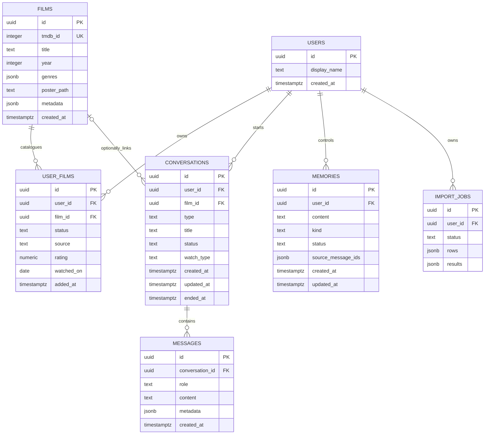

# NOACF — Database

> Source of truth: `supabase/migrations/0001_init.sql`,
> `0002_conversation_context.sql`, and `0003_import_jobs.sql`. Query behavior
> below is traced to `server/app/`. There is no ORM; FastAPI uses supabase-py
> against PostgREST with the service-role key.

## 1. Conventions and relationships

- Primary keys are UUIDs, normally generated by `gen_random_uuid()`.
- User-owned rows reference `public.users(id)`, which is 1:1 with
  `auth.users(id)` and cascades on Auth-user deletion.
- The application uses service-role DB access and explicit owner filters.
  RLS policies protect direct Supabase access as defence in depth.
- Core entities are relational. JSONB is used for variable TMDB metadata,
  message metadata, memory provenance, and import-job row/outcome payloads.

## 2. `public.users` — application profile

| Field | Type/default | Purpose and constraints |
|---|---|---|
| `id` | uuid PK, FK → `auth.users.id`, cascade | Joins application data to Supabase Auth |
| `display_name` | text, nullable | Greeting and mock-assistant personalization |
| `created_at` | timestamptz, `now()` | Profile creation time |

Sign-up inserts the profile. `GET /auth/me` upserts a missing id as a self-heal
for older Auth users (`server/app/routers/auth.py`). There is no profile-update
or account-delete endpoint. RLS allows the owner to select/insert/update their
own row; no owner delete policy is declared.

## 3. `public.films` — shared metadata cache

| Field | Type/default | Purpose and constraints |
|---|---|---|
| `id` | uuid PK | Internal film identity used by all user data |
| `tmdb_id` | integer, unique, nullable | TMDB identity/upsert key; nullable for possible manual catalogue entries |
| `title` | text, required | Display and import matching |
| `year` | integer, nullable | Release year from TMDB |
| `genres` | jsonb, default `[]` | Array of TMDB genre names |
| `poster_path` | text, nullable | Converted to an image-CDN URL by `poster_url` |
| `metadata` | jsonb, default `{}` | Currently `overview`, `runtime`, `vote_average`, `original_language` |
| `created_at` | timestamptz, `now()` | Cache insertion time |

`_ensure_film` reads by `tmdb_id`, fetches TMDB details only when absent, and
upserts on `tmdb_id` (`server/app/routers/films.py`). Any authenticated role may
SELECT this table through RLS; no normal-user write policy exists. Writes occur
through the service role. There is no catalogue deletion endpoint or cache TTL.

## 4. `public.user_films` — a user’s relationship to a film

| Field | Type/default | Purpose and constraints |
|---|---|---|
| `id` | uuid PK | Library-row id used by PATCH/DELETE |
| `user_id` | uuid FK → `users`, cascade | Owner |
| `film_id` | uuid FK → `films`, cascade | Catalogue film |
| `status` | text, required | CHECK `watched` or `watchlist` |
| `source` | text, default `manual` | CHECK `manual` or `letterboxd` |
| `rating` | numeric(2,1), nullable | CHECK 0–5; import parsing accepts 0.5–5 |
| `watched_on` | date, nullable | Watch/diary date when supplied |
| `added_at` | timestamptz, `now()` | Library ordering |

The composite **unique(user_id, film_id)** constraint makes repeat imports and
manual saves idempotent. It also means repeat viewings are not separate records.
`user_films_user_idx(user_id, status)` supports owner/status library reads;
uniqueness also creates a database index.

Read behavior: `GET /films/mine` joins `films`, filters `user_id` and optional
status, orders by `added_at DESC`, and uses range pagination with exact count.
Write behavior: POST and import upsert on `(user_id, film_id)`; PATCH and DELETE
filter both row id and owner id. Missing ratings/dates in a later import do not
erase existing values (`_attempt_row`). Deleting a `films` row would cascade to
library rows; the application does not expose such a delete.

## 5. `public.conversations` — reflection/discovery session

| Field | Type/default | Purpose and constraints |
|---|---|---|
| `id` | uuid PK | Conversation identity |
| `user_id` | uuid FK → `users`, cascade | Owner |
| `film_id` | uuid FK → `films`, nullable, ON DELETE SET NULL | Optional film context |
| `type` | text, required | CHECK `reflection` or `discovery` |
| `title` | text, nullable | Generated film title or free-reflection prompt |
| `status` | text, default `active` | CHECK `active` or `completed` |
| `watch_type` | text, nullable (0002) | CHECK `seen` or `planning` when present |
| `created_at` | timestamptz, `now()` | Creation time |
| `updated_at` | timestamptz, `now()` | List ordering and latest activity |
| `ended_at` | timestamptz, nullable (0002) | Set when ended |

`conversations_user_idx(user_id, status, updated_at DESC)` supports My
Reflections. Creation inserts the row; message posting updates `updated_at`;
ending sets status and `ended_at` idempotently. Routes filter by id/user
ownership. There is an owner DELETE policy in SQL but no application
conversation-delete endpoint.

Although `type='discovery'` is accepted by the API, there is no distinct
recommendation engine behind it. `watch_type` changes mock-question selection;
it does not alter the user’s library status.

## 6. `public.messages` — append-only conversation history

| Field | Type/default | Purpose and constraints |
|---|---|---|
| `id` | uuid PK | Message identity and potential memory provenance |
| `conversation_id` | uuid FK → `conversations`, cascade | Parent history |
| `role` | text, required | CHECK `user`, `assistant`, or `system` |
| `content` | text, required | Verbatim message text |
| `metadata` | jsonb, default `{}` | Opening currently uses `{kind: "opening"}` |
| `created_at` | timestamptz, `now()` | Chronology and bounded retrieval |

`messages_conversation_idx(conversation_id, created_at)` supports history and
recent-context queries. Application behavior is insert-only: the opening, each
user message, and each assistant reply are new rows; no route updates or deletes
messages. RLS allows SELECT and INSERT only when the parent conversation
belongs to the caller and declares no owner UPDATE or DELETE policy.

**Important distinction:** append-only is an application convention backed by
limited direct-user policies, not a trigger preventing service-role updates.
Deleting a conversation would cascade to messages, although no such API flow
currently exists.

## 7. `public.memories` — user-controlled reflective profile (schema seam)

| Field | Type/default | Purpose and constraints |
|---|---|---|
| `id` | uuid PK | Memory identity |
| `user_id` | uuid FK → `users`, cascade | Owner |
| `content` | text, required | Insight text; intended to be user-editable |
| `kind` | text, default `insight` | CHECK `theme`, `preference`, or `insight` |
| `status` | text, default `proposed` | CHECK `proposed`, `confirmed`, or `rejected` |
| `source_message_ids` | jsonb, default `[]` | Intended provenance links to source messages |
| `created_at` | timestamptz, `now()` | Creation time |
| `updated_at` | timestamptz, `now()` | Orders confirmed-memory retrieval |

`memories_user_status_idx(user_id, status)` supports the only active query:
`confirmed_memories` selects content for the owner where status is `confirmed`,
orders by `updated_at DESC`, and limits results (default five). Proposed and
rejected rows are excluded.

**Not implemented:** extraction, insertion by a review flow, status transitions,
editing, contradiction handling, recommendation use, provenance display, and a
user-facing forget/delete flow. SQL has owner select/insert/update/delete
policies, but no memory routes exist. The intended user-only transition rule is
not encoded as a database trigger; it must be enforced by future server code.

## 8. `public.import_jobs` — resumable import state (0003)

| Field | Type/default | Purpose |
|---|---|---|
| `id` | uuid PK | Public import id |
| `user_id` | uuid FK → `users`, cascade | Owner |
| `source_filename` | text, nullable | Original filename only |
| `target_status` | text, required | `watched` or `watchlist`, inferred from filename |
| `status` | text, default `queued` | `queued`, `processing`, `completed`, `completed_with_errors`, or `failed` |
| `total_rows` | integer, default 0 | Valid normalized CSV rows |
| `processed_rows` | integer, default 0 | Unique rows with an outcome |
| `added_count` | integer, default 0 | New library writes |
| `updated_count` | integer, default 0 | Existing rows changed |
| `duplicate_count` | integer, default 0 | Repeat/already-current rows |
| `unmatched_count` | integer, default 0 | Rows with no match |
| `failed_count` | integer, default 0 | Temporary row failures |
| `next_row` | integer, default 0 | Highest checkpointed source index + 1 |
| `rows` | jsonb, default `[]` | Normalized name/year/rating/watched_on only |
| `results` | jsonb, default `{}` | Source index → outcome and optional error |
| `error` | text, nullable | Job-level failure detail |
| `created_at` | timestamptz, `now()` | Job creation |
| `updated_at` | timestamptz, `now()` | Checkpoint heartbeat/stale detection |
| `completed_at` | timestamptz, nullable | Final completion time |

Indexes are `import_jobs_user_idx(user_id, created_at DESC)` and
`import_jobs_status_idx(status, updated_at)`. RLS includes owner
select/insert/update/delete policies. Worker reads/writes use the service role;
API reads are owner-scoped. `serialise_job` returns counts and normalized
unmatched/failure details but deliberately omits the raw `rows` and `results`
payloads.

There is no job deletion or expiry process. Completed job payloads therefore
remain until manually removed or the Auth user is deleted.

## 9. Data lifecycle by domain

| Domain | Create | Read | Update | Delete |
|---|---|---|---|---|
| Auth/profile | Supabase admin + `users.insert`; `/auth/me` repairs | `/auth/me` | Password via Auth admin; no display-name route | No account-delete flow |
| Film metadata | `_ensure_film` cache upsert | Search/details/library/conversation joins | Upsert on TMDB id when fetched again | No catalogue deletion/TTL |
| User library | POST/import upsert | Paginated owner join | PATCH by owner or import upsert | DELETE `/films/mine/{id}` |
| Conversation | POST `/conversations` | Owner list/detail; full messages | `updated_at`, status, `ended_at` | SQL policy exists; no API flow |
| Message | Opening/user/assistant inserts | Chronological history or recent N for context | **No application updates** | No application deletes; cascade if parent deleted |
| Memory | **No implemented creation flow** | Latest confirmed K for chat only | **No implemented lifecycle flow** | SQL owner policy only; no API flow |
| Import job | CSV upload insert | Owner progress/detail | Batches, resume, recovery updates | No deletion/expiry flow |

## 10. RLS summary

- `users`: owner select/insert/update.
- `films`: SELECT for authenticated users; no ordinary-user write policy.
- `user_films`: owner select/insert/update/delete.
- `conversations`: owner select/insert/update/delete.
- `messages`: SELECT/INSERT only if the parent conversation is owned; no owner
  update/delete policies.
- `memories`: owner select/insert/update/delete.
- `import_jobs`: owner select/insert/update/delete.

These policies do not constrain the service-role key. The backend’s explicit
ownership filters are therefore essential. The repository includes user
isolation tests for import jobs and not-found behavior for conversations, but
not a complete direct-PostgREST RLS test suite for every policy.

## 11. Privacy and data-retention implications

1. **Reflection text can be highly personal.** Full user and assistant messages
   are retained indefinitely in `messages`; there is no user-facing deletion or
   retention interval. Ending a conversation does not erase it.
2. **Memory is a derived profile.** The intended design limits assistant context
   to confirmed memories, which is a meaningful privacy/control boundary.
   However, creation/edit/forget controls are not yet implemented, and a future
   real provider would send recent reflections plus confirmed memories to that
   provider. Provider-specific consent and retention must be decided before the
   swap.
3. **Current mock processing stays in-process.** No reflection text is sent to
   an external AI service by `MockLLMProvider`.
4. **TMDB receives film queries, not account details.** Search and import send
   title/year and TMDB ids. The full CSV is not sent to TMDB, although individual
   titles from it are queried.
5. **Import jobs retain more than the library.** They keep normalized titles,
   years, ratings, watched dates, per-row outcomes, and error text after
   completion. There is no cleanup job. If only the final library is needed long
   term, a retention policy for completed jobs should be considered.
6. **Bearer token and job id are in localStorage.** `noacf_token` is accessible
   to JavaScript running on the origin, so XSS prevention matters. The import
   job id is not a credential but can reveal progress when used with a valid
   session. No token or secret should be written to docs/logs.
7. **Service-role key is highly privileged.** It must remain only in
   `server/.env`; the client has no Supabase configuration. Repository `.env`
   rules and `.env.example` support this separation.
8. **Auth-user deletion cascades application rows** through foreign keys, but
   the application exposes no self-service account deletion and no evidence of
   operational deletion/retention procedures.
9. **Shared catalogue is not user-private**, but deleting a shared film has
   consequences: `user_films` cascades while `conversations.film_id` becomes
   NULL. This should be considered before any cache-cleanup feature.

## 12. Schema gaps and recommendations (not implemented)

- Add explicit retention/deletion requirements for messages and import jobs.
- Decide whether append-only messages need trigger-level enforcement rather
  than convention plus policies.
- Add pagination if conversation/message volume grows beyond current demo use.
- Add pgvector only if plain SQL retrieval is shown to be insufficient (D8);
  there is no current embedding or vector-search column.
- Design recommendation feedback storage only when the Phase 6 approach is
  chosen; no such table exists now.

